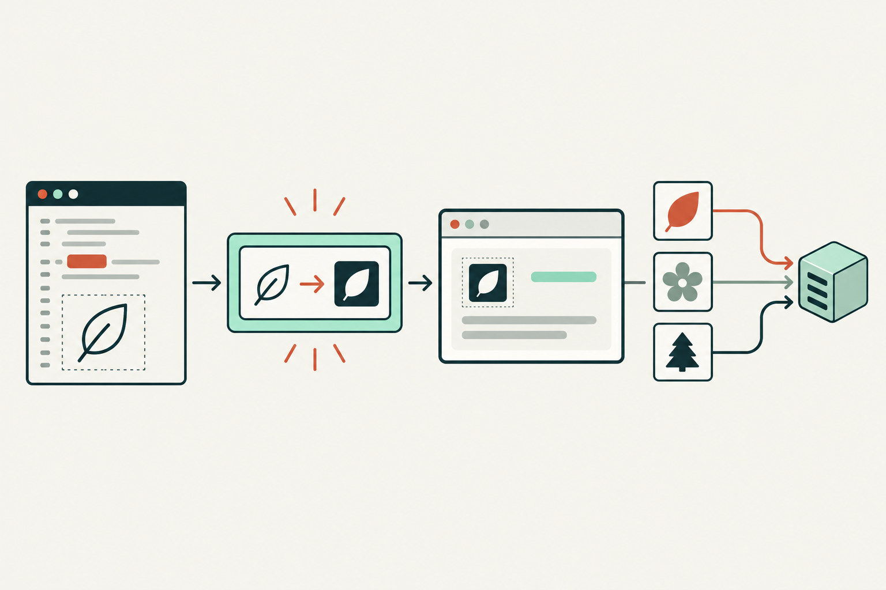

<!-- This file is generated by mdtheme. Edit README.md.src instead. -->

# Semion

[](https://oss.sebastian-software.com) [](https://www.npmjs.com/package/semion) [](https://www.npmjs.com/package/semion) [](https://github.com/sebastian-software/semion/actions/workflows/ci.yml) [](https://nodejs.org/) [](package.json)

Semion gives React and Vite projects a readable `<Icon name="search" />` API
without folding SVG path data into JavaScript. At build time, Vite resolves
each static name, imports the corresponding SVG as an external asset, and
rewrites the marker to a small span whose CSS mask points to that file. Only
icons used by a module enter its dependency graph.



Each used SVG is a separate content-hashed asset. HTTP/2 and HTTP/3 can
multiplex many icon requests over one connection, while a CDN can cache each
URL independently. That gives applications another useful caching option;
whether separate files or a bundle load faster depends on reuse, cache policy,
and the page. Semion leaves that choice in the asset and delivery layer.

The Vite adapter is written in TypeScript and uses the existing native
`oxc-parser` package to parse JSX and TSX. It edits the original module and
returns a source map. It does not build or ship a custom Rust addon.

## Install

Semion is an ESM package for React projects using Vite. It requires Node.js
20.19+ or 22.12+, React 18+, and Vite 8+.

```sh
npm install semion react
npm install --save-dev vite @vitejs/plugin-react @types/react
```

Semion is published as `semion@0.1.0`. The Vite plugin includes its base mask
styles automatically; there is no separate stylesheet import to remember.

## Use the API

Put SVG files in `src/icons`. Semion uses each top-level filename without the
`.svg` suffix as the icon name:

```tsx
import { Icon } from "semion";

export function SearchButton() {
  return (
    <button className="icon-button" type="button" aria-label="Search">
      <Icon name="search" aria-hidden="true" className="button-icon" />
    </button>
  );
}
```

The icon inherits the button's color through `currentColor`. Set its size with
an ordinary class:

```css
.icon-button {
  color: #2458d3;
}

.button-icon {
  width: 1.5rem;
  height: 1.5rem;
  mask-size: cover;
}

.icon-button:hover {
  color: #b4235a;
}

.icon-button:disabled {
  color: #98a2b3;
}
```

You can also override a default inline style directly:

```tsx
<Icon name="search" style={{ width: "2rem", height: "2rem" }} />
```

Register the plugin before the React plugin in `vite.config.ts`:

```ts
import react from "@vitejs/plugin-react";
import { defineConfig } from "vite";
import { semion } from "semion/vite";

export default defineConfig({
  plugins: [semion(), react()],
});
```

By default, the plugin scans `src/icons` and writes
`src/semion.generated.d.ts` when Vite starts; it refreshes the declaration
during builds and icon changes. Each top-level SVG filename without `.svg` is
an icon name. Include the generated file in the TypeScript project for
`Icon` name completion and validation. A project that includes `src` already
picks it up; if `tsconfig.json` has a narrower `include`, add the generated
file there. If you set `typesFile`, include that path instead. Before Vite has
generated the declaration, `IconName` falls back to `string`, so TypeScript
cannot catch a misspelled name yet.

## Run the example

The interactive React and Vite [demo](examples/vite-react) uses local Lucide
search, settings, and heart SVGs. It demonstrates generated name completion,
class and style-prop sizing, inherited color, hover, pressed, and disabled
states, plus the JSX-to-HTML transform. Try it on the
[Semion website](https://sebastian-software.github.io/semion/).

```sh
pnpm install
pnpm --filter semion build
pnpm --filter semion-vite-react-example dev
```

The example assets and their upstream license notices are in
`examples/vite-react`.

The default icon directory is `src/icons`. Set `iconDir` to change it. Set
`typesFile` to change the generated TypeScript declaration path. The plugin
writes `src/semion.generated.d.ts` by default, providing `Icon` name completion
from the configured SVG files.

## What the transform does

- `name` must be a string literal such as `name="search"`. Unknown names and
  dynamic names fail the Vite transform with a source location.
- Every used SVG is imported from its source module with `?no-inline`. Vite
  keeps the SVG outside JavaScript even when the file is tiny. Unused SVG files
  do not enter the bundle.
- Repeated uses in one source module share one generated import. An icon used
  only by a lazy module stays in that module's dependency graph.
- Other JSX props keep their order and are evaluated once. Semion preserves
  spreads, `className`, `style`, and accessibility attributes. Its helper
  removes any runtime `name` value and sets the selected `maskImage` and
  `WebkitMaskImage` after the caller's style, so a spread cannot change which
  icon the module uses.
- The transform imports one shared virtual stylesheet automatically. Vite
  deduplicates it across transformed modules. Its base rules use
  `:where(.semion-icon)`, which has zero specificity, so ordinary unlayered
  app classes can override size, alignment, and mask sizing. No package CSS
  import or mask setup is needed.
- The icon uses `currentColor`, so app CSS can set color for hover, active,
  disabled, and theme states. A React `style` prop can override CSS defaults;
  the selected mask URL remains fixed.
- Semion's base rules are unlayered. Normal rules inside a CSS cascade layer
  cannot override unlayered rules, regardless of selector specificity. Put
  overrides that need to win in unlayered app CSS; Semion does not change the
  app's layer configuration.
- The plugin runs in Vite's `pre` tier, before the React JSX transform. It does
  not change Vite's global asset inlining setting.

Put button or link semantics on the containing control. For decorative icons,
pass `aria-hidden="true"`; for informative icons, provide an accessible name
or nearby text.

## From JSX to HTML

For the search button above, the Semion transform runs before React's JSX
transform. It removes the marker import, adds the external SVG import, and
imports the shared virtual stylesheet. It replaces `<Icon>` with a span. This
is the generated module the React JSX transform receives:

```tsx
import __semionIcon0 from "./icons/search.svg?no-inline";
import "virtual:semion/styles.css";

function __semionIconProps(props, asset) {
  const result = { ...props };
  delete result.name;
  const mask = "url(" + JSON.stringify(asset) + ")";
  return {
    ...result,
    className: result.className ? "semion-icon " + result.className : "semion-icon",
    style: { ...result.style, maskImage: mask, WebkitMaskImage: mask },
  };
}

export function SearchButton() {
  return (
    <button className="icon-button" type="button" aria-label="Search">
      <span {...__semionIconProps({["aria-hidden"]: "true", ["className"]: "button-icon"}, __semionIcon0)} />
    </button>
  );
}
```

The React JSX transform compiles the span, and React renders HTML like this.
The selected SVG is an external asset, so its production hash varies between
builds:

```html
<button class="icon-button" type="button" aria-label="Search"><span aria-hidden="true" class="semion-icon button-icon" style="mask-image:url(&quot;/assets/search-abc123.svg&quot;);-webkit-mask-image:url(&quot;/assets/search-abc123.svg&quot;)"></span></button>
```

The SVG paths stay in the external asset, not in the DOM. The virtual
stylesheet supplies the span's base size, color, and mask defaults; the
button's color flows through `currentColor`.

## Scope

The current release handles named imports of `Icon` from `semion` in JSX or
TSX. The icon directory is scanned at the top level; duplicate filename stems
are rejected. Semion does not edit SVG paths at runtime, manage icon packs,
provide other framework adapters, or ship a rendering registry. The marker
throws if it reaches React without the Vite plugin.

Semion is published as an ESM-only package. The `semion` entry exports the
React marker and types, and `semion/vite` exports the Vite plugin. The package
is dual-licensed under MIT OR Apache-2.0; users may choose either license for
Semion's first-party code. Its tarball includes the built JavaScript,
declarations, README, and both license texts. Example Lucide and Feather
assets retain their separate upstream terms and are excluded from the npm
package.

---

<p align="center">
  <a href="https://oss.sebastian-software.com"></a><br />
  TypeScript, React &amp; Rust consulting<br />
  Experts in Agentic Software Development<br />
  <a href="https://sebastian-software.de">Work with us</a> · <a href="https://oss.sebastian-software.com">More open source</a>
</p>

<p align="center">Copyright &copy; 2026 Sebastian Software GmbH</p>
